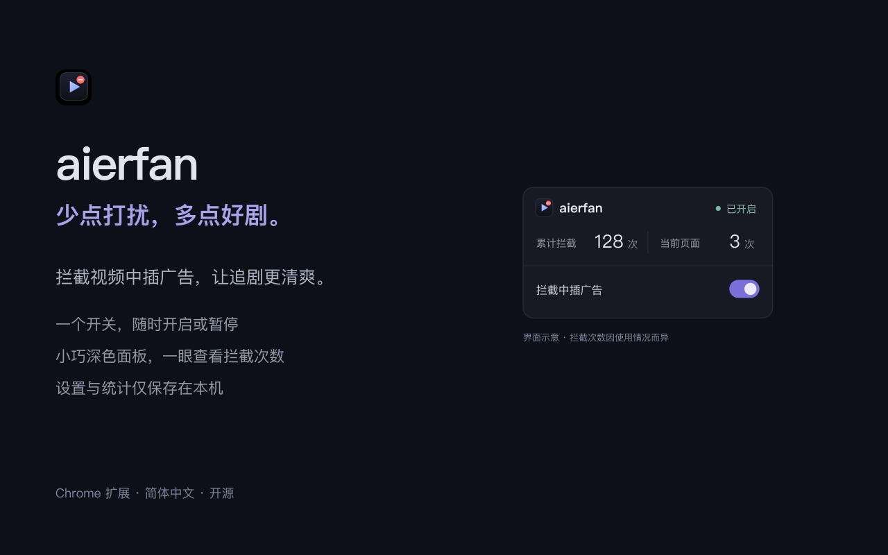

# aierfan

给在海外用 ayf 追剧的朋友做的 Chrome 小插件：拦截已适配播放器的定时中插广告，中文界面，一个开关即可开启或暂停。

设置与拦截次数仅保存在本机，不收集个人数据。视频内嵌广告、网页横幅等不保证能拦截；网站播放器更新可能影响兼容性。

[Chrome 应用商店](https://chromewebstore.google.com/detail/aierfan/gikjmbpepikgpkhonacmiiaajdjgajki) · [问题反馈](https://github.com/Rorogogogo/aierfan/issues) · [MIT License](LICENSE)



A small Chrome extension that blocks scheduled mid-roll ads on **ayf (kubb.tv)**. Independent project; not affiliated with the video website.

## Controls

Click the pinned **aierfan** toolbar icon to open the popup. It shows the ad-blocking switch, cumulative blocked-ad count, and current page count. On supported pages, the small **aierfan** pill at the bottom right opens the same controls. Press Escape to collapse the page panel.

The interface is in Simplified Chinese. Settings and counts stay in `chrome.storage.local` on your device. There is no telemetry or external service.

## What it blocks

The extension suppresses the adapted player's JavaScript mid-roll scheduler before it starts an ad countdown or replaces the episode source. Each blocked ad shows a three-second notification. Turning the switch off restores the original scheduler behavior.

It targets scheduled mid-video ads. Banners, ads baked into the video, other preroll players and server-side ads are outside the verified scope. It does not change video quality, membership, purchases, coins, account fields or media URLs.

## Install locally

Clone or download this repository first:

```sh
git clone https://github.com/Rorogogogo/aierfan.git
cd aierfan
```

1. Open `chrome://extensions` and enable Developer mode.
2. Click **Load unpacked** and select the `extension` folder.
3. Pin **aierfan**, then refresh your kubb.tv tabs.

After updating the files, click **Reload** on the aierfan card in `chrome://extensions`, then refresh your video tab. Existing counts and the ad-blocking preference are preserved when reloading the same installed extension. The obsolete quality preference is ignored.

The unpacked extension is in this repository’s `extension/` directory. No build step or dependencies are required.

## Implementation

- `core.js` validates and patches the observed scheduler interface.
- `main.js` runs in the page's MAIN world at document start and intercepts the `bgqT` Webpack scheduler factory. It has no HLS or video-service hooks.
- `content.js` owns storage, page status and the floating control, in Chrome's isolated world.
- `ui.js` renders the shared card and accessible switch inside a Shadow DOM.
- `popup.html` / `popup.js` provide the toolbar popup. The popup uses extension messaging to read the current page's scheduler status. On other sites it explains where the extension works.

The only extension permission is `storage`. Content scripts match only `https://www.kubb.tv/*` and `https://kubb.tv/*`. No new host permissions are needed for the toolbar popup.

## Verify

```sh
npm test
npm run test:live-source
```

Offline tests cover scheduler reversibility, Webpack interception, untouched HLS behavior, settings synchronization, popup behavior on unrelated sites and persistent counts. The optional live test downloads the current public site bundle without cookies or credentials and checks its real scheduler contract.

## Releases

Increment `extension/manifest.json` and `package.json`, then push a matching version tag. GitHub Actions runs tests, checks the tag matches the manifest version, builds a ZIP and submits the extension update to Chrome Web Store review through the Chrome Web Store API V2, using the configured OAuth secrets and the `CWS_ITEM_ID` and `CWS_PUBLISHER_ID` repository variables. Google controls review and approval. The **Verify Chrome Web Store credentials** workflow performs a read-only token and item-access check.

The source version is **0.2.2**. The Chrome Web Store version may differ while updates are under review.

## Limitations

The site can change its private scheduler interface. If the hook is unavailable, the panel shows **需适配**. Disable the extension and refresh if playback behaves unexpectedly. Enabling the switch while an ad is already playing does not end that ad; refresh the page afterward.

See [PRIVACY.md](PRIVACY.md) for the privacy policy.

## License

[MIT](LICENSE) — Copyright (c) 2026 Robert Wang.
